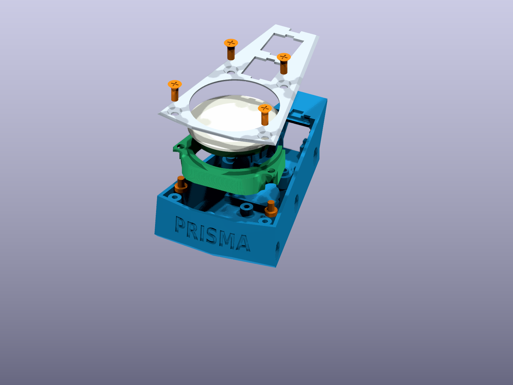

# Hidden trackpad retainer

The pad loads from underneath and sits 0.8 mm below the lid surface at rest.
The 0.7 mm-thick lid rim covers 0.8 mm of the pad edge nominally (0.5 mm at
maximum radial shift). One horseshoe-shaped holder supports the component-free
underside and is hidden with the lid installed. It holds the pad independently of
the tray, with 0.1 mm nominal axial play rather than pressure on the sensor.
PCBs, tray, lid height and key positions are unchanged.

The holder's ledge, 1.9 mm wide (radius 18.3 to 20.2 mm), runs round the front
of the pad from 22 degrees behind one side to 22 degrees behind the other; the
main board begins just past its ends. Below the lid bosses it widens toward the
tray walls and reaches down to 10.7 mm deep, 2.3 mm over the sensor board. Its
outside is carved to the path it takes as the lid closes about the rear hooks.
In the model a press at the back edge moves the pad about 0.05 mm before the lid
rim and holder stop it.



The holder uses two **M3 × 4 mm pan-head screws**
(under-head length, head ≤5.5 mm diameter and ≤2.0 mm height) in Ø2.5 mm,
3.4 mm-deep blind pilots, their heads sunk in counterbores. The holder seats against the two lid bosses, not against
the pad. With ±0.1 mm each for screw length and
thickness under the head, modeled engagement is 2.6–3.0 mm and tip clearance is at
least 0.4 mm, before print error at the pilot bottom. Verify actual pull-out
strength and at least 0.4 mm tip clearance. Do not substitute the M3 × 8
enclosure screws.

Use the 1.8 mm breakout spacer to recover cable room under the recessed pad.
Check the actual spacer and components against the screw heads, and verify
the FFC bend and slack during closure.

## Regeneration and qualification

The revised lid and clips are exported as source/public STL pairs. To reproduce
them and the trackpad views without changing PCB fabrication files, run:

```sh
python -m pip install -r requirements.txt
mkdir -p /tmp/opencode
python trackpad/trackpad.py
python -m unittest test_module_assembly test_stl_export test_drawer
python check_fit.py
python verify_artifacts.py
python vrml.py
python scene.py
./kicad.sh python3 render_boards.py
views="$(git ls-files 'renders/trackpad*.png' | xargs -n1 basename) dock_unibody.png dock_unibody_side.png"
./render.sh $views
python render_manifest.py --update $views
python page.py
```

Physical qualification remains open. Check that the slicer produces a
continuous rim and that the actual overlay has an inactive edge wide enough
for the overlap and any shift. Verify free play without preload, screw seating
and pull-out strength, retention and service, key travel, wired closure, and
touch response near the rim with both controller options. Replace the old lid
and clips together.
